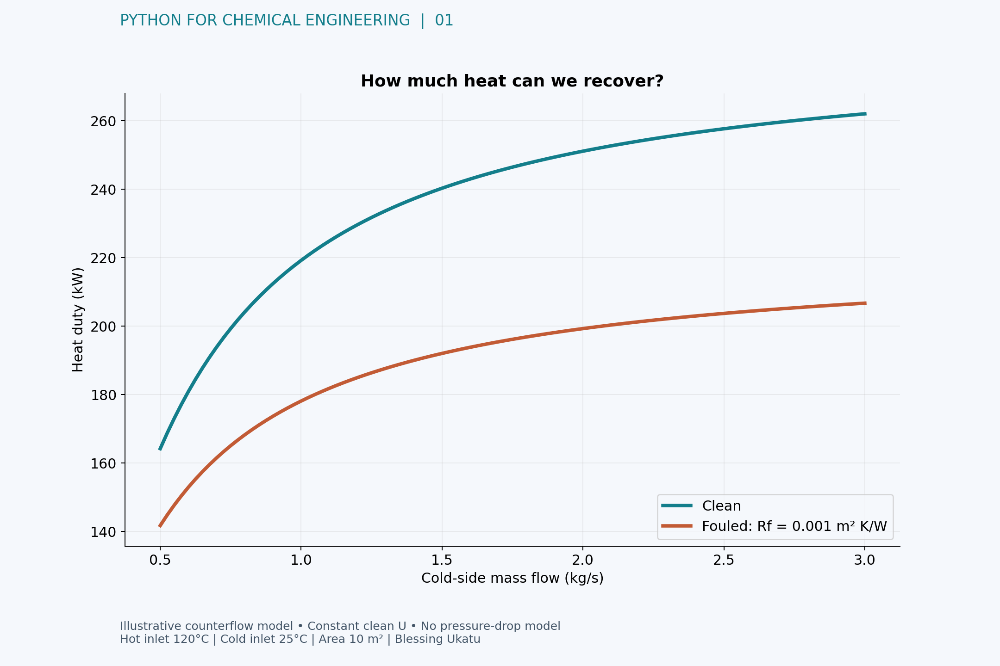
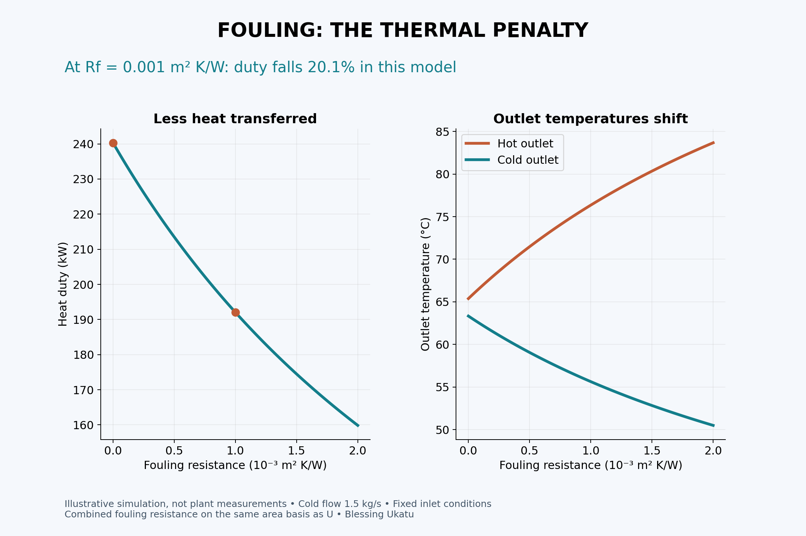

# Heat recovery and fouling in Python

**Python for Chemical Engineering | Project 01** by Blessing Ukatu

An educational, steady-state counterflow heat-exchanger study; not plant data,
equipment certification or a validated industrial design. No HYSYS or IDAES run is claimed.

## Run

Install Python 3, then run `pip install -r requirements.txt` and `python model.py`.
The script regenerates the CSV, two figures and results.json, and runs verification checks.
Dependencies are unpinned; tested runtime versions are in environment.txt.

## Engineering question

At fixed inlet temperatures and exchanger area, how do cold-side flow and an
additional thermal resistance affect heat duty and outlet temperatures?

## Assumed inputs (chosen for this educational example)

| Input | Value |
|---|---:|
| Hot inlet | 120 °C |
| Cold inlet | 25 °C |
| Hot mass flow | 2 kg/s |
| Hot heat capacity | 2200 J/(kg K) |
| Cold heat capacity | 4180 J/(kg K) |
| Reference cold mass flow | 1.5 kg/s |
| Heat transfer area | 10 m² |
| Clean overall coefficient | 500 W/(m² K) |
| Combined fouling resistance sweep | 0–0.002 m² K/W |
| Cold mass flow sweep | 0.5–3 kg/s |

Properties are illustrative constants, not a specified fluid composition or property database.
Assumptions: single phase, no ambient heat loss, ideal counterflow, constant properties,
no axial conduction. Clean U is held constant even while flow changes: this isolates
capacity-rate effects but does not represent flow-dependent convection. Pressure drop,
pumping costs, fouling growth with time, cleaning schedules and economics are excluded.
Rf is combined extra resistance on the SAME area basis as U and A; do not add
tube-side and shell-side resistances without the appropriate area conversion.

## Equations and worked base case

Ch = mh cp,h = 2 × 2200 = 4400 W/K.
Cc = mc cp,c = 1.5 × 4180 = 6270 W/K.
Cmin = 4400 W/K; Cr = 4400/6270 = 0.701754.
U = 1/(1/Uclean + Rf).
NTU = U A/Cmin = 500 × 10/4400 = 1.136364 (clean).
For Cr != 1, effectiveness = (1 − exp[−NTU(1−Cr)])/(1 − Cr exp[−NTU(1−Cr)]).
For Cr = 1, effectiveness = NTU/(1+NTU).
Clean effectiveness = 0.574949.
Qmax = Cmin(Th,in − Tc,in) = 4400 × 95 = 418000 W.
Q = effectiveness × Qmax = 240328.717 W = 240.329 kW.
Th,out = 120 − Q/4400 = 65.380 °C.
Tc,out = 25 + Q/6270 = 63.330 °C.

At Rf = 0.001 m² K/W:
U = 1/(1/500 + 0.001) = 333.333 W/(m² K).
Recomputing effectiveness gives Q = 192.053 kW, hot outlet 76.352 °C,
cold outlet 55.630 °C.
Duty reduction = (240.328717 − 192.052519)/240.328717 × 100 = 20.0876%.
This is specific to these assumptions, not a general industrial loss estimate.

## Verification and interpretation

Nine cases were independently recalculated by solving Q = UA × LMTD using
SciPy's bracketing root solver. For counterflow, terminal differences are
Th,in − Tc,out and Th,out − Tc,in. Maximum duty difference was below 1e-10 kW.
Energy balance, temperature bounds, zero-area limit and equal-capacity-rate
limit also passed. These are numerical/analytical verification, not experimental validation.
The CSV contains 2601 computed scenarios (51 resistance values × 51 flows),
not 2601 measurements or independent experiments.

Higher cold-side flow in this fixed-U model raises heat duty but does not establish
an economic optimum. Fouling reduces U and duty; the hot stream leaves warmer and
the cold stream leaves cooler at the same inlet conditions and flow rates.

## Sources

1. ASHRAE Handbook—Fundamentals (2025), Chapter 4, Heat Transfer, heat-exchanger
effectiveness and NTU relationships:
https://handbook.ashrae.org/handbooks/F25/SI/f25_ch04/f25_ch04_si.aspx
2. Purdue University, ME 418, Heat Exchanger Analysis and Design (24 September 2024),
counterflow effectiveness–NTU analysis:
https://www.purdue.edu/freeform/me418/wp-content/uploads/sites/30/2024/09/ME-418-Heat-Exchanger-Analysis-and-Design-Annotated-Sept-24.pdf
3. IDAES, Heat Exchanger (Lumped Capacitance), documented thermal-resistance approach:
https://idaes-pse.readthedocs.io/en/latest/reference_guides/model_libraries/generic/unit_models/heat_exchanger_lc.html

References support the theory. All numerical inputs and results here belong to this
illustrative study; they were not copied from those sources. 

## Key concepts

- U combines heat-transfer resistances; adding resistance lowers U.
- Effectiveness is actual duty divided by the maximum thermodynamic duty.
- Energy transferred out of the hot stream must equal that received by the cold stream.
- The model cannot determine plant savings or a maintenance interval without additional data.

## Files

- `model.py`: executable model and verification checks
- `data/sensitivity.csv`: 2,601 computed scenarios
- `figures/`: the two graphs above
- `results.json`: reference results for the clean and fouled cases
